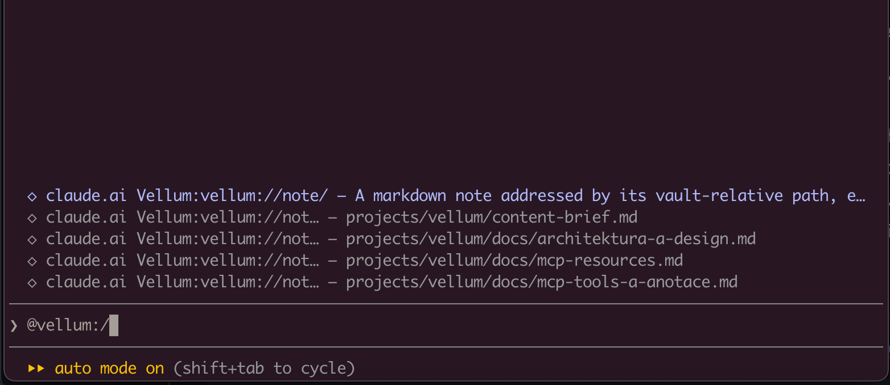

# vellum

> *a calm window into a folder of markdown*

[](https://github.com/freema/vellum/releases)
[](https://github.com/freema/vellum/actions/workflows/ci.yml)
[](go.mod)
[](LICENSE)
[](https://github.com/freema/vellum/pkgs/container/vellum)
[](https://freema.github.io/vellum/)

A lightweight **MCP server** over a folder of markdown files. One static Go
binary with an embedded web UI, one ~24 MB Docker image, ~5 MB idle RAM.
Run it on your laptop next to your editor (`vellum mcp ~/notes`), or
self-host it with `docker compose up -d`.

**Deliberately light**: the smallest stack that just works, for one person
or a small team.

- **Your data is flat markdown.** Portable, readable in any editor, git or
  Obsidian. No lock-in, no database, no embeddings.
- **vellum never calls an LLM itself.** The optional curator tools prepare
  context; the agent on *your* side decides.
- **The vault layer is dumb and deterministic.** Everything is a file;
  config is environment variables.
- **Structure is a feature.** `inbox/`, `projects/`, `archive/`, not a
  pile of files. Unfiled notes land in the inbox, and a folder can say
  what it is for in an `_index.md` note.
- **Small MCP tool surface** (17 tools) and lean answers: agents read an
  outline, a section or a page of hits instead of whole notes, so less
  context is burned.
- **Sharing is a link, not an export.** Any note can become a read-only
  URL for someone who has no account; it always shows the current
  version and dies the moment you revoke it. Off by default.

Every note is also a first-class **MCP resource** (`vellum://note/{path}`),
so your agent can attach a note as context straight from its resource
picker, no tool call needed:



## Run locally

No server, no Docker, no Go: one binary and a folder of notes.

### Install

The archives, mise and `vellum mcp` arrive together, with the first
release whose [release page](https://github.com/freema/vellum/releases/latest)
lists `vellum_*` archives. Until then, use the Docker command under
[Connect a client](#connect-a-client): it runs with every published image.

**Release archive** (Linux, macOS, Windows; amd64 and arm64). Pick the file
for your platform from the [latest release](https://github.com/freema/vellum/releases/latest):
`vellum_{linux,darwin}_{amd64,arm64}.tar.gz` or
`vellum_windows_{amd64,arm64}.zip`.

```sh
curl -LO https://github.com/freema/vellum/releases/latest/download/vellum_darwin_arm64.tar.gz
gh attestation verify vellum_darwin_arm64.tar.gz --repo freema/vellum   # optional: built by this repo's release workflow
tar xzf vellum_darwin_arm64.tar.gz vellum
mkdir -p ~/.local/bin && mv vellum ~/.local/bin/   # or any folder on your PATH
export PATH="$HOME/.local/bin:$PATH"   # also add this line to ~/.zshrc or ~/.bashrc
vellum -version
```

The archive names carry no version, so these links always point at the
newest stable release. If macOS refuses to start a binary you downloaded
with a browser, `xattr -d com.apple.quarantine vellum` clears the
quarantine flag (`curl` does not set it).

**mise**: `mise use -g github:freema/vellum` installs the same binary.

**Homebrew** (coming: the tap is not published yet): `brew install
freema/tap/vellum`, update with `brew upgrade vellum`.

**Go**: `go run github.com/freema/vellum/cmd/vellum@latest mcp ~/notes`
works anywhere a command does, but builds without the web UI. It needs
the same release as the archives: an older version does not know `mcp`
and starts the HTTP server instead.

### Connect a client

The folder must exist (`-init` creates it), and `~/` is expanded by
vellum, so it also works in JSON configs that no shell reads.

**Claude Code**:

```sh
claude mcp add --scope user vellum -- vellum mcp ~/notes
```

`--scope user` makes vellum available in every project; without it, only
in the folder where you ran the command.

**Claude Desktop**: open `vellum.mcpb` from the
[latest release](https://github.com/freema/vellum/releases/latest) and pick
your notes folder; Desktop runs vellum for you. Or add it by hand under
*Settings → Developer → Edit Config*:

```json
{
  "mcpServers": {
    "vellum": {
      "command": "/path/to/vellum",
      "args": ["mcp", "~/notes"]
    }
  }
}
```

**Cursor**: the same block in `~/.cursor/mcp.json` (or `.cursor/mcp.json`
in a project).

Use the full path that `which vellum` prints: apps started from the Dock or
Start menu do not see your shell's PATH.

**Docker, nothing installed**:

```sh
claude mcp add --scope user vellum -- docker run -i --rm --user "$(id -u):$(id -g)" \
  -v "$HOME/notes:/vault" ghcr.io/freema/vellum -mcp-stdio
```

`--user` makes the container write as you. Without it the image's
non-root user (uid 65532) can read your notes but, on Linux, cannot write
to a folder you own.

### Two local modes

- **stdio** (`vellum mcp ~/notes`): every client starts its own vellum
  process. The simplest setup: no port, no UI.
- **Local HTTP** (`vellum -vault ~/notes`): one process serves the web UI
  at http://127.0.0.1:8080 and MCP at `/mcp`, and every client shares its
  index. Recommended when several clients use the vault at once:

  ```sh
  claude mcp add --scope user --transport http vellum http://localhost:8080/mcp
  ```

  A plain binary listens on `127.0.0.1` only, so auth can stay off. To
  reach it from another machine set `VELLUM_HOST=0.0.0.0` and turn on
  `AUTH_ENABLED` (see [Configuration](#configuration)).

### Next to your editor

Edit the same folder in Obsidian or VS Code, `git pull` into it, or let two
clients each run their own `vellum mcp`: changes made outside vellum show up
in search, tags, backlinks and tasks within a few seconds, without a
restart. Before a call that reads the index, vellum checks the disk once
`VELLUM_RESCAN` (default `5s`) has passed. There is no file watcher and no
background work, so it behaves the same on Docker bind mounts and network
drives. Known limits: a change shows at the next call after the interval,
not the moment you save; an edit that keeps both the file size and the
modification time is not noticed; the web UI shows outside changes on its
next load. Details: [docs/search.md](docs/search.md#notes-changed-outside-vellum).

### What vellum is, and is not

vellum is one binary that lets an agent read *and write* a folder of
markdown. It runs no models, keeps no database and no index on disk, and
makes no calls out: search is a BM25F-ranked scan in RAM that understands
typos, accents and Czech word forms, not meaning. If you want semantic
search over the same notes, run a tool built for it (for example
[qmd](https://github.com/tobi/qmd)) next to vellum over the same folder.
Both just read the files.

## Self-host with Docker

Pre-built multi-arch images (amd64 + arm64) are published to
[GitHub Container Registry](https://github.com/freema/vellum/pkgs/container/vellum)
on every release:

```sh
docker pull ghcr.io/freema/vellum:latest
```

### Try it in one command

```sh
mkdir -p vault
docker run --rm -p 8080:8080 -v "$PWD/vault:/vault" ghcr.io/freema/vellum
```

Open http://localhost:8080: that's your vault, served straight from
`./vault`. Auth is off by default, which is fine on localhost; enable it
before exposing anything (see below).

> **Linux bind mounts:** the container runs as a non-root user
> (uid 65532, distroless), so the mounted directory must be writable by
> it: `sudo chown 65532 vault`. Docker Desktop on macOS/Windows handles
> this for you.

### Docker Compose (recommended)

Create a `docker-compose.yml`. This is [the same file](docker-compose.yml)
the repo ships (`curl -fsSLO
https://raw.githubusercontent.com/freema/vellum/main/docker-compose.yml`
grabs it if you'd rather not paste):

```yaml
services:
  vellum:
    image: ${VELLUM_IMAGE:-ghcr.io/freema/vellum:latest}
    container_name: vellum
    restart: unless-stopped
    ports:
      - "${VELLUM_PORT:-8080}:8080"
    env_file:
      - path: .env
        required: false
    environment:
      PORT: "8080"
      VELLUM_VAULT_PATH: /vault
    volumes:
      - ./vault:/vault
    # hardening: the binary only ever writes into the mounted vault
    read_only: true
    security_opt:
      - no-new-privileges
    deploy:
      resources:
        limits:
          memory: 256M
```

Generate a secret and start:

```sh
cat > .env <<EOF
AUTH_ENABLED=true
VELLUM_CLIENT_SECRET=$(openssl rand -hex 32)
EOF
docker compose up -d
curl http://localhost:8080/healthz
```

Open http://localhost:8080, paste the client secret: that's your vault.

Everything else is tunable from the same `.env`: pin the image with
`VELLUM_IMAGE=ghcr.io/freema/vellum:1.13.0` (recommended for production,
since `latest` moves), change the host port with `VELLUM_PORT`, plus any
variable from the [configuration table](#configuration). The image already
listens on all interfaces (`VELLUM_HOST=0.0.0.0`), so compose files need no
change.

## Connect Claude

For a local vault see [Connect a client](#connect-a-client). For a server,
the connector URL **must end with `/mcp`**:

```sh
claude mcp add --transport http vellum https://your-host/mcp
```

Claude runs the OAuth flow: a browser window opens vellum's consent screen,
you enter your `VELLUM_CLIENT_SECRET` and approve (authorization code +
PKCE; vellum is its own OAuth issuer — no external identity provider, no
calls out). The secret is what stops anyone else who can reach the server
from approving a connection of their own. The same works for a
[claude.ai custom connector](https://claude.ai/settings/connectors) — either
leave the OAuth fields empty and enter the secret on the consent screen, or
enter `vellum` as client ID and your secret there and approve with one click.

### MCP tools

`list_notes`, `read_note`, `read_notes`, `write_note`, `patch_note`,
`replace_in_note`, `append_to_note`, `prepend_to_note`, `delete_note`,
`move_note`, `search_notes`, `list_tags`, `add_tags`, `remove_tags`,
`get_backlinks`, `set_status`, `list_tasks`, plus, with
`VELLUM_CURATOR=on`: `suggest_location`, `suggest_tags`, `suggest_links`,
`find_untagged`, `find_orphans`, `find_inbox_stale`,
`find_undescribed_folders`, and with `VELLUM_SHARING=on`: `share_note`,
`unshare_note`.

Agents read only what they need:

- `search_notes` ranks with BM25F and returns pages of 20 notes, each with
  a relevance `score` from 0 to 1 (`min_score: 0.3` keeps the clear
  matches), plus `total`, `truncated` and a hint where the next page
  (`offset`) starts. `response_format: "concise"` returns just the path,
  title and line of the first match: about 2 kB for 20 hits.
- `read_note` reads a whole note or just a part: `outline: true` (headings
  with line numbers), `section` (one heading and everything under it, also
  as a path such as `Project A > Notes`), or `start_line` / `max_lines`.
  Line numbers are the ones `search_notes` reports.
- `read_notes` reads up to 20 notes in one call, by `paths` or a glob
  `pattern`, within a byte budget; a note over the budget is skipped with
  its size, never cut.
- `list_notes` returns at most 200 notes per call plus `dirs`, the
  subfolders with their note counts. `sort: "modified"` with `since: "7d"`
  shows what changed recently.

Edits use the smallest tool that fits: `replace_in_note` swaps an exact
piece of text, `patch_note` replaces a section or adds to it (`operation`:
`append`, `prepend`, `insert_before`, `insert_after`), and `write_note`
rewrites a whole note. Writes are conflict-safe: every read returns a
content hash, write tools accept `expected_hash` and fail on mismatch
instead of clobbering. A section name that matches several headings is an
error listing them, never a guess.

On typical agent tasks (find and read the relevant part, read a long note's
section, fix a sentence) the tools now send about 13 % of the bytes v1.12.1
did ([docs/payload-baseline.md](docs/payload-baseline.md)).

Every tool carries MCP annotations (`readOnlyHint`, `destructiveHint`,
`idempotentHint`), and the handshake ships short server instructions with
the vault conventions, so agents behave well out of the box. The full
tool/resource reference lives in [docs/mcp.md](docs/mcp.md).

### MCP resources

Notes are also exposed as resources: `vellum://note/{path}` serves the raw
markdown (`text/markdown`), so clients with a resource picker can attach a
note as context without a tool call. Clients can `resources/subscribe` to a
note URI and receive `notifications/resources/updated` whenever that note
changes, whether the change came through MCP, the web editor or another
editor on the same folder.

## Web workspace

The embedded UI is a three-pane workspace (tree, list, editor) that stays
in sync with the vault on its own: MCP writes appear without a reload, a
deleted note switches to a designed 410 state, and a deploy restart shows
a reconnect overlay instead of a dead page. Filters (folder, tags,
type/status) live in the URL so views are shareable and refresh-safe;
theme and editor mode persist locally. Details (URL scheme, storage
keys, autosave/conflict/flush semantics): [docs/workspace.md](docs/workspace.md).

## Sharing a note

Any note can become a link somebody else can open without an account,
for handing over a document your agent just wrote, without exporting it
or giving anyone access to the vault:

```sh
VELLUM_SHARING=on     # links + the share_note/unshare_note MCP tools
VELLUM_SHARING=ui     # links, but only you can create them
VELLUM_SHARING=off    # default
```

Then **Share** in the note header hands you
`https://your-host/s/<token>`. The link is a pointer, not a copy: the
reader always sees the current note, an edit shows up immediately, and
revoking takes effect on the next request. It follows the note when you
rename or move it, and dies with it when you delete it. Frontmatter is
never served, and the page is one document: no tree, no search, no way
into the rest of the vault.

Links live in `<vault>/.vellum/shares.json`, so they survive a restart
(unlike the in-memory OAuth tokens) and travel with your vault backup.
Full reference (lifetimes, headers, rate limits, what a leaked link
costs): [docs/sharing.md](docs/sharing.md).

## Vault structure, tasks, curator

- **Structure**: an empty vault is initialized with `inbox/`, `projects/`,
  `archive/` (disable with `VELLUM_INIT_STRUCTURE=false`). A `write_note`
  without a path files the note into the inbox under a title slug.
  Pointing vellum at an existing vault changes nothing.
- **Folder descriptions**: an `_index.md` note in a folder says what the
  folder is for (frontmatter `description:`, or its first paragraph, up to
  300 characters). `search_notes` returns the descriptions of the result
  folders once per answer in `contexts`, `list_notes` shows them on
  `dirs`, and `suggest_location` matches their words. `_index.md` in the
  vault root describes the whole vault and goes into the server
  instructions. Agents write them with `write_note`; the file name is
  `VELLUM_CONTEXT_FILE`.
- **Tasks**: a note with `type: task` and `status: backlog | in-progress |
  done` in the frontmatter. `set_status` edits just those lines; the UI and
  `list_tasks` filter by state and project. Notes without a type are
  `knowledge`.
- **Curator** (`VELLUM_CURATOR=on`, default off): deterministic context
  tools: folder suggestions by tag and description overlap, tag vocabulary
  for a note, link candidates, untagged/orphaned/stale-inbox lists, folders
  that still lack a description. No API keys, no LLM calls from the server,
  moves stay behind the regular `move_note`.

## Configuration

```sh
vellum [-vault DIR]           # web UI, REST API and MCP over HTTP
vellum mcp [-init] DIR        # MCP over stdio for one local client
vellum -healthcheck           # probe the running server (Docker HEALTHCHECK)
```

The vault comes from the `DIR` argument or `-vault`, then
`VELLUM_VAULT_PATH`. `vellum -mcp-stdio` with `VELLUM_VAULT_PATH` still
works the same as `vellum mcp`.

| Variable | Default | Description |
| --- | --- | --- |
| `VELLUM_HOST` | `127.0.0.1` (Docker: `0.0.0.0`) | HTTP listen address; set `0.0.0.0` to accept connections from the network, and turn on auth when you do |
| `PORT` | `8080` | HTTP listen port |
| `VELLUM_VAULT_PATH` | `./vault` | Vault directory (Docker: `/vault`). Only HTTP mode falls back to `./vault` |
| `VELLUM_RESCAN` | `5s` | How often the index checks the disk for notes changed outside vellum (a duration or seconds; `off` disables) |
| `VELLUM_CONTEXT_FILE` | `_index.md` | File name of folder description notes (in the vault root: the vault's description) |
| `AUTH_ENABLED` | `false` | OAuth 2.1 with a single client secret, **required for anything public** |
| `VELLUM_CLIENT_ID` | `vellum` | OAuth client id |
| `VELLUM_CLIENT_SECRET` | (none) | The access key (`openssl rand -hex 32`, min 32 chars) |
| `VELLUM_ISSUER_URL` | `http://localhost:PORT` | **Public HTTPS URL when behind a proxy**; without it OAuth metadata advertises localhost and clients fail |
| `TRUST_PROXY` | `false` | Set `1` behind Caddy/Traefik so rate limiting sees real client IPs |
| `CORS_ORIGINS` | claude.ai, claude.com | Origins receiving CORS headers (localhost always allowed) |
| `VELLUM_ALLOWED_ORIGINS` | claude.ai, claude.com | Browser origins allowed on `/mcp` + `/api` (same-origin and localhost always pass) |
| `VELLUM_REDIRECT_URIS` | any | Optional exact OAuth redirect allowlist |
| `VELLUM_INIT_STRUCTURE` | `true` | Create inbox/projects/archive in an empty vault |
| `VELLUM_INBOX_DIR` / `VELLUM_PROJECTS_DIR` / `VELLUM_ARCHIVE_DIR` | `inbox`/`projects`/`archive` | Conventional directory names |
| `VELLUM_CURATOR` | `off` | Enable the suggest_*/find_* context tools |
| `VELLUM_SHARING` | `off` | Public read-only note links: `off` / `ui` (you mint them) / `on` (agents may too) |
| `VELLUM_RANKER` | `bm25f` | Search ranking; `legacy` restores the pre-BM25F order for the transition |

## Deployment

vellum stays on the internal network; only your reverse proxy is exposed.
Set `VELLUM_ISSUER_URL=https://<domain>`, `TRUST_PROXY=1` and terminate TLS
in the proxy. A bare-metal install behind a proxy on another host also
needs `VELLUM_HOST=0.0.0.0`. Details and a smoke-test checklist:
[docs/deployment.md](docs/deployment.md).

### One-click PaaS (Railway / Render / Fly.io)

The easiest path if you don't want to run a VPS: deploy the published image
on a platform that gives you TLS and a public URL for free. vellum honours
the `PORT` the platform injects, so the only three things that matter are the
**same everywhere**:

1. **Image**: `ghcr.io/freema/vellum:1.13.0` (pin a version, not `:latest`).
2. **A persistent volume mounted at `/vault`**. This is not optional: vellum
   stores every note as a file; without a persistent disk your vault is wiped
   on the next redeploy. (Serverless hosts like Vercel/Netlify/Cloudflare
   Pages have no persistent writable disk and can't run vellum; use one of
   the platforms below.)
3. **Env** (from the [configuration table](#configuration)):

   ```sh
   AUTH_ENABLED=true
   VELLUM_CLIENT_SECRET=<openssl rand -hex 32>
   VELLUM_ISSUER_URL=https://<your-public-url>   # the URL the platform gives you
   TRUST_PROXY=1                                 # you're behind the platform's proxy
   ```

Set `VELLUM_ISSUER_URL` once you know the assigned URL, then redeploy: OAuth
metadata must advertise the real HTTPS host or Claude fails after the consent
step.

- **Railway**: New Project → Deploy from Docker image →
  `ghcr.io/freema/vellum:1.13.0`. Add a Volume mounted at `/vault`, set the env
  above (Railway provides `PORT` and a `*.up.railway.app` domain).
- **Render**: New → Web Service → *Deploy an existing image* →
  `ghcr.io/freema/vellum:1.13.0`. Add a Disk mounted at `/vault`, set the env.
- **Fly.io**: `fly launch --image ghcr.io/freema/vellum:1.13.0`, then
  `fly volume create vault` and mount it at `/vault` in `fly.toml`; set the env
  with `fly secrets set VELLUM_CLIENT_SECRET=… VELLUM_ISSUER_URL=… TRUST_PROXY=1 AUTH_ENABLED=true`.

Then connect Claude to `https://<your-public-url>/mcp` (see
[Connect Claude](#connect-claude)).

**Coolify / Traefik**: point Coolify at the repo or image
`ghcr.io/freema/vellum:1.13.0` (pin a version, not `:latest`), mount a
volume at `/vault`, set the env from the table above. Running raw
compose behind Traefik, uncomment the labels in `docker-compose.yml`:

```yaml
labels:
  - traefik.enable=true
  - traefik.http.routers.vellum.rule=Host(`vellum.example.com`)
  - traefik.http.services.vellum.loadbalancer.server.port=8080
```

**Caddy** is two lines:

```
vellum.example.com {
    reverse_proxy vellum:8080
}
```

Security posture (read-only container, threat model, what is never
logged): [SECURITY.md](SECURITY.md), [docs/threat-model.md](docs/threat-model.md),
[docs/logging.md](docs/logging.md).

## Development

Requires Go 1.25+, [Task](https://taskfile.dev), and Node 22 for the SPA.

```sh
task build              # Go binary without the SPA (no node needed)
task build-full         # SPA + Go binary with the UI embedded
task test               # go test ./...
task lint               # golangci-lint
task e2e                # compose stack with the fixture vault (docs/e2e.md)
task payload            # bytes each MCP tool returns per agent scenario
task release-snapshot   # all release archives into dist/, nothing published
```

Start with [CONTRIBUTING.md](CONTRIBUTING.md) for the local setup and the
ground rules, and [ARCHITECTURE.md](ARCHITECTURE.md) for the map of the
code. Every page of documentation is listed in [docs/](docs/README.md).

### Design decisions kept deliberately simple

- **Search = ranked RAM scan, not bleve.** The metadata index narrows by
  tag/dir, content is matched from an in-memory cache invalidated precisely
  by the index (modTime+size), and results are ranked with BM25F: a match
  in the title, path, headings or tags counts more than one in the body,
  and rare words more than common ones. Matching is case-, diacritics- and
  typo-insensitive ("preklapy" finds "překlepy") and knows Czech word
  forms. A query over a 2 000-note vault takes ~0.4 ms warm
  ([docs/search.md](docs/search.md)); ranking quality is measured on a
  golden query set ([docs/search-quality.md](docs/search-quality.md)).
  Zero heavy dependencies, no index to corrupt, no warm-up. The `Searcher`
  interface exists so bleve can slot in *if it ever hurts*.
- **Plain CSS custom properties, not Tailwind.** The design system is a
  fixed token sheet (`DESIGN.md`); custom properties map to it 1:1 with no
  build-time dependency.
- **Opaque in-memory tokens, not JWTs.** Tokens die with the process and
  clients silently re-authorize; no signing keys to manage.
- **No database, ever (v1).** Tags, backlinks and task states live in an
  in-RAM index rebuilt in ~50 ms at startup and kept in step with outside
  edits by a lazy rescan.

## Why vellum and not …?

- **Obsidian + plugins**: vellum doesn't replace your editor; it happily
  serves the same vault folder to your agent while you keep editing
  anywhere. No sync, no plugin sandbox, no Electron on the server.
- **Notion/Anytype-style apps**: those own your data. vellum's "database"
  is `ls` and `grep`-able markdown.
- **Heavier MCP note servers**: vellum ships one binary or one 24 MB
  container, no vector DB, no API keys, and burns minimal agent context
  (17 tools).

## Author

Created by **Tomáš Grasl** ([@freema](https://github.com/freema)).

Issues and PRs welcome: see [CONTRIBUTING.md](CONTRIBUTING.md), and
[SUPPORT.md](SUPPORT.md) for where to ask. The
[threat model](docs/threat-model.md) and [SECURITY.md](SECURITY.md) explain
the boundaries contributions must keep.

## License

[MIT](LICENSE)
